# MedAIx mockup → Flutter implementation spec

Source: `docs/mockup/medaix-mockup.html` (copy of `C:\Users\TahaSync\Downloads\medaix-mockup.html`, untouched).
Renders: `docs/mockup/screens/*.png`, 2× scale, 390 × 810 phone frame (`-full` variants are the frame stretched to the full scroll height). Rendered with headless Chrome at `--force-device-scale-factor=2` with Figtree loaded from Google Fonts.

Everything below is read **directly from the mockup's CSS/JS**; nothing is estimated unless marked *extrapolated*.

---

## 0. Summary

| | |
|---|---|
| Screens | 12 top-level screens (`onboard`, `home`, `upload`, `report`, `trends`, `meds`, `scan`, `doctor`, `wellness`, `qr`, `docscan`, `settings`) with 22 distinct states, plus two global overlays (offline banner, toast). |
| Themes | Dark (default, `data-t="d"`) and light (`data-t="l"`). Both captured for every state (54 PNGs). Light/dark are authored as two independent palettes, not inverted. |
| Navigation | **No AppBar.** Every screen is a scroll view with an in-content `h1` title + optional subtitle. A **floating glass pill bottom nav** (5 tabs: Home / Reports / Meds / Wellness / More) sits 14 px above the bottom edge. Hidden on onboarding. Secondary screens (report, trends, scan) keep their parent tab highlighted. |
| Visual language | Figtree everywhere. Translucent "glass" cards with hairline borders and `backdrop-filter: blur(16px)`, **no card shadows**; the nav is the only shadowed surface. Two soft radial glows (slate, mauve) sit behind the page content. Pill buttons (48 high). Status is always icon + word, colour-only never. Line icons (24 viewBox, 1.8 stroke, round caps). |
| Brand palette | Pure Ink/Navy/Slate/Mauve. **The blue→teal logo gradient does not appear anywhere in the UI.** |

### Screenshot index

| Screen / state | Dark | Light |
|---|---|---|
| Onboarding | [onboarding-dark](screens/onboarding-dark.png) | [onboarding-light](screens/onboarding-light.png) |
| Home | [home-dark](screens/home-dark.png) · [full](screens/home-dark-full.png) | [home-light](screens/home-light.png) · [full](screens/home-light-full.png) |
| Home · offline banner | [home-offline-dark](screens/home-offline-dark.png) · [full](screens/home-offline-dark-full.png) | [home-offline-light](screens/home-offline-light.png) · [full](screens/home-offline-light-full.png) |
| Home · toast | [home-toast-dark](screens/home-toast-dark.png) · [full](screens/home-toast-dark-full.png) | [home-toast-light](screens/home-toast-light.png) · [full](screens/home-toast-light-full.png) |
| Upload · empty | [upload-empty-dark](screens/upload-empty-dark.png) | [upload-empty-light](screens/upload-empty-light.png) |
| Upload · loading | [upload-loading-dark](screens/upload-loading-dark.png) | [upload-loading-light](screens/upload-loading-light.png) |
| Upload · error | [upload-error-dark](screens/upload-error-dark.png) | [upload-error-light](screens/upload-error-light.png) |
| Simplified report | [report-dark](screens/report-dark.png) · [full](screens/report-dark-full.png) | [report-light](screens/report-light.png) · [full](screens/report-light-full.png) |
| Risk trend | [trends-dark](screens/trends-dark.png) | [trends-light](screens/trends-light.png) |
| Meds · empty | [meds-empty-dark](screens/meds-empty-dark.png) | [meds-empty-light](screens/meds-empty-light.png) |
| Meds · list | [meds-list-dark](screens/meds-list-dark.png) | [meds-list-light](screens/meds-list-light.png) |
| Meds · interaction | [meds-interaction-dark](screens/meds-interaction-dark.png) | [meds-interaction-light](screens/meds-interaction-light.png) |
| Scan · permission | [scan-permission-dark](screens/scan-permission-dark.png) | [scan-permission-light](screens/scan-permission-light.png) |
| Scan · viewfinder | [scan-viewfinder-dark](screens/scan-viewfinder-dark.png) | [scan-viewfinder-light](screens/scan-viewfinder-light.png) |
| Scan · matched | [scan-matched-dark](screens/scan-matched-dark.png) | [scan-matched-light](screens/scan-matched-light.png) |
| Doctor · no symptom | [doctor-empty-dark](screens/doctor-empty-dark.png) | [doctor-empty-light](screens/doctor-empty-light.png) |
| Doctor · recommended | [doctor-selected-dark](screens/doctor-selected-dark.png) | [doctor-selected-light](screens/doctor-selected-light.png) |
| Wellness | [wellness-dark](screens/wellness-dark.png) | [wellness-light](screens/wellness-light.png) |
| QR share · empty | [qr-empty-dark](screens/qr-empty-dark.png) | [qr-empty-light](screens/qr-empty-light.png) |
| QR share · active | [qr-active-dark](screens/qr-active-dark.png) | [qr-active-light](screens/qr-active-light.png) |
| Doctor portal | [doctor-portal-dark](screens/doctor-portal-dark.png) | [doctor-portal-light](screens/doctor-portal-light.png) |
| Settings | [settings-dark](screens/settings-dark.png) · [full](screens/settings-dark-full.png) | [settings-light](screens/settings-light.png) · [full](screens/settings-light-full.png) |

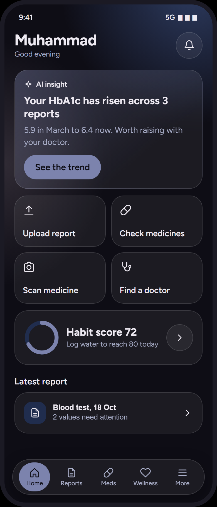 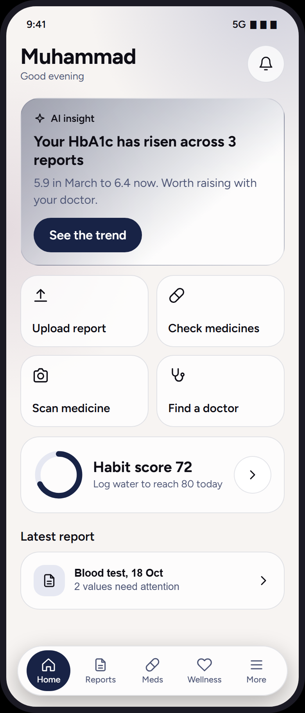

---

## 1. Design tokens (exact CSS values)

### 1.1 Colour

CSS custom properties on `.ph[data-t=…]`. Flutter token name in the last column is the proposed `AppColors` field.

| Role | CSS var | Dark | Light | Flutter |
|---|---|---|---|---|
| Page background | `--bg` | `#0E0D15` (Ink) | `#F7F4F2` (warm off-white) | `background` |
| Surface 1 (skeleton shimmer base only) | `--s1` | `#141A2A` | `#FFFFFF` | `surface` |
| Surface 2 (icon tiles, progress track, toggle track, skeleton highlight) | `--s2` | `#202D4E` | `#E6E8F2` | `surface2` |
| Primary (filled buttons, selected chips, active nav item, progress fill, sparkline, ring) | `--pr` | `#7C83AD` (Slate) | `#182346` (Navy) | `primary` |
| On primary | `--on` | `#0E0D15` | `#FFFFFF` | `onPrimary` |
| Text | `--tx` | `#EEEAF2` | `#0E0D15` | `text` |
| Muted text | `--mu` | `#A9AEC8` | `#4D5575` | `muted` |
| **Glass fill** (cards, tiles, chips, icon buttons, nav) | `--gl` | `rgba(255,255,255,0.06)` | `rgba(255,255,255,0.75)` | `glass` |
| **Glass border** (hairline on every glass surface, list dividers) | `--gb` | `rgba(255,255,255,0.13)` | `rgba(24,35,70,0.12)` | `glassBorder` |
| Success | `--ok` | `#5FB89A` | `#1F7A5C` | `ok` |
| Warning | `--wn` | `#E0B15C` | `#8A5A00` | `warn` |
| Error | `--er` | `#E5768A` | `#B3283F` | `error` |
| Glow 1 (top-right radial) | `--glow1` | `#3D5387AA` (Steel @ 67 %) | `#7C83AD55` (Slate @ 33 %) | `glowPrimary` |
| Glow 2 (left radial) | `--glow2` | `#BFA9BA30` (Mauve @ 19 %) | `#BFA9BA55` (Mauve @ 33 %) | `glowSecondary` |
| Viewfinder backdrop | literal | `#05050A` | `#05050A` | `viewfinder` |
| Viewfinder text/check | literal | `#FFFFFF` | `#FFFFFF` | `onViewfinder` |
| Scan frame + sweep line | literal | `#BFA9BA` (Mauve) | `#BFA9BA` | `scanFrame` |
| QR modules / QR paper | literal | `#0E0D15` / `#FFFFFF` | same | `qrInk` / `qrPaper` |
| Offline banner fill | computed | `color-mix(warn 18 %, transparent)` → `warn.withValues(alpha: .18)` | same | `warnTint` |
| Toast plate / toast text | computed | `--tx` / `--bg` | `--tx` / `--bg` | `text` / `background` |
| AI insight gradient | computed | `linear-gradient(140deg, color-mix(primary 38 %, transparent), glass 70 %)` | same formula | see §1.8 |

Composited reference values (for designers checking flat renders only; implement the alphas, not these):
glass over dark bg ≈ `#1D1C23`; glass border over dark ≈ `#2D2C33`; glass over light bg ≈ `#FDFCFC`; glass border over light ≈ `#DCDBDD`.

Contrast (WCAG, computed): dark `muted` on `background` 9.6:1; light `muted` on `background` 7.0:1; `onPrimary` Ink on Slate 5.3:1; white on Navy 14.2:1; dark `warn` on `background` 9.1:1; light `warn` on white 5.6:1; light `error` on white 6.5:1. Nav label 11 px is the only sub-12 px text; keep it `labelSmall` and let it scale.

### 1.2 Typography

Font: **Figtree** (weights 400, 500, 600, 700 loaded), fallback `system-ui, sans-serif`. One family for everything, including body. (The current app pairs Figtree with Noto Sans for body; the mockup does not.)

| Role | CSS selector | Size | Weight | Line-height | Tracking | Flutter `TextTheme` slot |
|---|---|---|---|---|---|---|
| Screen title | `h1` | 28 | 700 | 1.15 (≈32) | −0.4 | `headlineMedium` |
| Card title / value | `h2` | 19 | 650 → **600** (nearest loaded weight) | 1.25 (≈24) | 0 | `titleLarge` |
| Section heading | `h3` | 16 | 600 | normal (≈1.2) · margin `20 0 10` | 0 | `titleMedium` |
| Body | `p` | 15 | 400 | 1.45 (≈22) | 0 | `bodyLarge` / `bodyMedium` |
| Small / subtitle | `.sm` | 13 | 400 | 1.45 (≈19) | 0 | `bodySmall` |
| Eyebrow tag in card | `.tag` | 13 | 600 | normal | 0 | `labelMedium` |
| Status label | `.st` | 13 | 600 | normal | 0 | `labelMedium` |
| Button | `.btn` | 16 | 600 | normal | 0 | `labelLarge` |
| Chip | `.ch` | 13 | 500 | normal | 0 | `labelMedium` w500 |
| Action tile label | `.tile` | 15 | 600 | normal | 0 | `titleSmall` |
| Nav label | `.nav button` | 11 | 500 | normal | 0 | `labelSmall` |
| Toast | `#toast` | 14 | 600 | normal | 0 | `bodyMedium` w600 |
| Status bar (OS, do not build) | `.sb` | 13 | 600 | | | – |
| Bold inline (`<b>` list titles) | `b` | inherits 15 | 700 | | | `bodyLarge` w700 |

Muted copy = same style with `color: muted`. Subtitles under `h1` are `.mu .sm` (13/400 muted).

### 1.3 Spacing

| Token | Value | Where |
|---|---|---|
| Page padding | `48 18 110` (top / sides / bottom) | `#scr`. Top clears the status bar (40 high); bottom clears the nav (64 + 14 inset + 32 breathing). Flutter: `SafeArea top` + 8, sides **18**, bottom `14 + 64 + 32 + safe-bottom`. |
| Header → content | 18 | `.hd margin-bottom` |
| Card padding | 16 | `.card` |
| Card stack gap | 12 | `.card margin-bottom`, `.grid margin-bottom` |
| Grid gap | 10 | `.grid` 2 columns |
| Row gap | 12 | `.row gap` |
| Chip wrap gap | 8 | `.row` with `gap:8px` on chip groups |
| Tile padding | 14 | `.tile` |
| List row padding | `12 0` | `.li` |
| Tag → next | 8 | `.tag margin-bottom` |
| Button top margin | 12 | `.btn margin-top` (every button, including stacked ghost) |
| Section heading | `20 0 10` | `h3` |
| h2 inside value card | `4 0` | report value |
| Body under h2 in AI card | 6 | `margin-top:6px` |
| Empty state padding | `26 8` | `.empty` |
| Empty icon → title | 12 | `.empty .ico margin-bottom` |
| Empty title → body | `6 0 4` | `.empty p` |
| Banner padding | `10 14` | `.ban` |
| Toast padding | `12 16`; inset `left/right 24, bottom 92` | `#toast` |
| Nav inset | 14 (left/right/bottom); inner `0 6` | `.nav` |
| Icon tile → text | 12 | `.row gap` |

Proposed scale: `xxs 2 · xs 4 · sm 6 · md 8 · lg 10 · xl 12 · xxl 14 · card 16 · header 18 · section 20 · page 18`.

### 1.4 Radii

| Element | Radius |
|---|---|
| Phone frame (not built) | 46 |
| Card | **24** |
| Action tile | 22 |
| Empty-state icon tile (64) | 22 |
| Icon tile (40) | 14 |
| Button (48 high) | 24 (full pill) |
| Compact button (44 high) | 24 (pill) |
| Icon button (48) | 24 (circle) |
| Chip (34 high) | 17 (pill) |
| Nav bar (64 high) | 32 |
| Nav item (56 × 52) | 26 |
| Progress bar (8 high) | 4 |
| Skeleton | 12 |
| Offline banner | 16 |
| Toast | 18 |
| Toggle track (52 × 30) | 15; knob 24 circle |
| Viewfinder | 26; inner frame 22 |
| QR paper | 20 |

### 1.5 Elevation / depth

- **Cards, tiles, chips, icon buttons: no shadow.** Depth = `glass` fill + 1 px `glassBorder` + `backdrop-filter: blur(16px)`.
- **Nav: the only shadow.** `0 10px 30px rgba(0,0,0,0.28)`, plus `blur(20px)` backdrop.
- Page glow (behind everything, `z-index:-1`):
  `radial-gradient(90% 40% at 90% -4%, glow1, transparent 70%)` and
  `radial-gradient(70% 35% at 0 32%, glow2, transparent 70%)`.
  Flutter: two `Positioned` `DecoratedBox`es with `RadialGradient(center: Alignment(0.8,-1.08), radius …)` or a `CustomPainter`; non-interactive, under the scroll view.
- Focus ring: `outline: 2px solid text; outline-offset: 2px` on `:focus-visible`.

### 1.6 Icons

Inline SVG, `viewBox 0 0 24 24`, `fill:none`, `stroke:currentColor`, `stroke-width:1.8`, round caps and joins. Default rendered size **20**; variants used: 14 (chip check / plus), 15 (status label), 16 (card tag), 22 (action tile), 28 (empty-state tile), 44 (scan success check).
Glyph set (Lucide-equivalent names): `home`, `file-text`, `pill`, `heart`, `menu`, `camera`, `qr-code`, `shield`, `check`, `alert-triangle`, `stethoscope`, `sparkles`, `plus`, `chevron-right`, `upload`, `bell`, `droplet`, `activity`, `trending-up`, `x`, `user`.
Flutter: use `lucide_icons` (exact match) or Material `*_outlined` equivalents at the same sizes; keep stroke look (avoid filled variants).

### 1.7 Components

| Component | Spec |
|---|---|
| **Primary button** `.btn` | Full width, `min-height 48`, radius 24, fill `primary`, text `onPrimary` 16/600, icon 20 + gap 8, `margin-top 12`. Disabled (`.btn[disabled]`): `opacity .5`. |
| **Ghost button** `.btn.g` | Same geometry. **`background: transparent`, `border: 1px solid glassBorder`, text `text`.** (Not a filled tonal button.) |
| **Compact button** `.btn.s` | `inline-flex`, `min-height 44`, `padding 0 20`, hugs content. Combine with `.g` for ghost compact ("Log walk"). |
| **Icon button** `.ib` | 48 × 48 circle, `glass` fill, 1 px `glassBorder`, icon 20 `text`. |
| **Card** `.card` | radius 24, padding 16, `glass` fill, 1 px `glassBorder`, blur 16, `margin-bottom 12`. |
| **AI card** `.card.ai` | Card + `linear-gradient(140deg, primary@38 % → glass at 70 %)`. |
| **Tag** `.tag` | Row: icon 16 + gap 6 + 13/600 text in `text` colour; status variants colour icon + text with `ok` / `warn` / `error`. `margin-bottom 8`. |
| **Status label** `.st` | Inline: icon 15 + gap 5 + 13/600, coloured text only (`ok` ✓, `warn` ⚠, `error` ⚠). **No container.** |
| **Action tile** `.tile` | `min-height 92`, radius 22, padding 14, `glass` + border, column `space-between`: icon 22 top-left, label 15/600 bottom-left. 2-column grid, gap 10. |
| **Chip** `.ch` | `min-height 34`, `padding 0 13`, radius 17, `glass` + border, 13/500 `text`, optional leading icon 14 + gap 6. **Selected** `.ch.on`: fill `primary`, text `onPrimary`, border transparent, leading check icon. |
| **Icon tile** `.ico` | 40 × 40, radius 14, fill `surface2`, icon 20 centred. Empty-state variant 64 × 64, radius 22, icon 28. |
| **List row** `.li` | Row, gap 12, `padding 12 0`, 1 px bottom `glassBorder`, last row no border. Trailing chevron 20 or toggle. `.li.er` colours text `error`. |
| **Progress bar** `.bar` | height 8, radius 4, track `surface2`, fill `primary`. |
| **Skeleton** `.sk` | radius 12, `linear-gradient(90deg, surface, surface2, surface)` at `200 % 100 %`, animates `background-position` to `-200 % 0`, 1.3 s infinite. |
| **Empty state** `.empty` | Centre-aligned, `padding 26 8`: 64 icon tile → h2 → muted p → buttons. |
| **Offline banner** `.ban` | Row gap 8, `padding 10 14`, radius 16, fill `warnTint`, 13 px `text`, ⚠ icon 16, `margin-bottom 12`. Pinned to top of scroll content. |
| **Toggle** `.tg` | 52 × 30, radius 15, track `surface2` → `primary` when on, knob 24 at `(3,3)` → `left 25`, knob `text` → `onPrimary` when on, `.2s`. |
| **Viewfinder** `.view` | 300 high, radius 26, fill `#05050A`, white text. Frame: inset `50 44`, 2 px `scanFrame` border, radius 22. Sweep line: 2 px `scanFrame`, `left/right 8`, animates `top 0 → 100 %` 2 s alternate infinite. |
| **Score ring** (home) | 64 × 64 SVG, `r 15` in 36 viewBox (scale 1.78), stroke 4, track `surface2`, arc `primary` round-cap, `dasharray 68 100`, `rotate(-90)`. |
| **Sparkline** (trends) | 300 × 90 viewBox, polyline `primary` stroke 3 round, dots r5 `primary`, dashed `warn` threshold `dasharray 4 5` at y 30. |
| **QR** | 21 × 21 modules, 200 × 200 rendered, `qrInk` on `qrPaper`, paper padding 12, radius 20, centred. |
| **Toast** `#toast` | Fixed above nav (`bottom 92`, `left/right 24`), `padding 12 16`, radius 18, plate `text`, copy `background` 14/600, `role=status`. Enter: opacity 0→1 + translateY 8→0 over `.25s`; auto-hide 1.8 s. |
| **Bottom nav** `.nav` | Absolute, `left/right 14, bottom 14`, height 64, radius 32, `glass` + border + blur 20 + shadow. 5 items `space-around`, inner padding `0 6`. Item 56 × 52 radius 26, column: icon 20 + gap 2 + label 11/500; inactive `muted`; **active: fill `primary`, icon+label `onPrimary`**. |
| **Header** `.hd` | Row `space-between`, `align-items center`, `margin-bottom 18`: left = h1 + optional `.mu.sm` subtitle; right = optional 48 icon button. |

### 1.8 Motion

| What | Rule |
|---|---|
| Toast | `transition .25s` opacity + translateY(8px); visible 1800 ms |
| Toggle knob | `transition .2s` |
| Skeleton shimmer | 1.3 s linear infinite |
| Scan sweep | 2 s infinite alternate |
| Screen change | Instant re-render; scroll reset to top. *Extrapolated:* Flutter fade-through ≤ 250 ms. |
| Simulated OCR | 1600 ms loading → report + toast |
| Reduced motion | `@media (prefers-reduced-motion: reduce) { * { animation:none; transition:none } }` → honour `MediaQuery.disableAnimations` for every duration. |

---

## 2. Screen-by-screen spec and mapping

Mapping targets are the files named in the brief (`app/lib/src/*.dart`, read at the start of this analysis). **Note:** the parallel implementation has since moved these to `app/lib/features/<feature>/ui/*_screen.dart`, `app/lib/core/widgets/*`, `app/lib/theme/*`; the widget names below refer to the `src/` versions and the §4 shared-widget names.

Legend for "Nav": which bottom tab is highlighted.

### 2.1 Onboarding → `onboarding_screen.dart` (`OnboardingScreen`)

Nav: **hidden**. 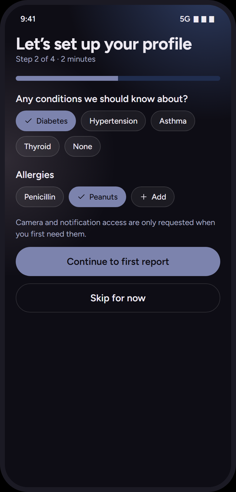

Layout (top→bottom):
1. `h1` "Let’s set up your profile" · subtitle "Step 2 of 4 · 2 minutes"
2. Progress bar 8 px, 50 % (`aria-valuenow 50`)
3. `h3` "Any conditions we should know about?"
4. Chip wrap (gap 8): **✓ Diabetes** (selected), Hypertension, Asthma, Thyroid, None
5. `h3` "Allergies"
6. Chip wrap: Penicillin, **✓ Peanuts** (selected), **+ Add**
7. Muted small (mt 16): "Camera and notification access are only requested when you first need them."
8. Primary "Continue to first report" → upload
9. Ghost "Skip for now" → home

Differs from current: current is a 3-step `TextField` questionnaire (name/age/sex → weight/height → conditions/medications/allergies) with a `_StepIndicator` of 3 gradient segments, an `AppBar` "Set up your profile", `IconTile(gradient: true)` headers, and `AppCard`-wrapped fields. Mockup: no AppBar, title in content, **chip multi-select** for conditions/allergies, a single thin progress bar, plain `Continue`/`Skip` pills, and the "N of 4" copy (mockup shows only step 2 of 4; steps 1, 3, 4 are *extrapolated*: 1 = about you (name/age/sex chips), 3 = medicines chips + Add, 4 = measurements).

Checklist:
- [ ] Remove `AppBar`; render `ScreenHeader(title, subtitle)`.
- [ ] Replace `_StepIndicator` with 8 px `ProgressBar(value: step/total)`.
- [ ] Conditions/allergies become `AppChip` wraps with a "+ Add" chip opening a text sheet; keep free-text fallback for API fields.
- [ ] Keep the age/sex/weight/height fields on their own steps using mockup inputs (*extrapolated*: `surface2` fill, radius 16, 48–52 high, no border, 2 px `text` focus border).
- [ ] CTA copy: "Continue", last step "Continue to first report"; secondary ghost "Skip for now".
- [ ] Hide bottom nav during onboarding.

### 2.2 Home → `router.dart` (`HomeScreen`) + `shell.dart` (`HomeShell`)

Nav: Home. 

Layout:
1. Header: `h1` "Muhammad" (user's first name) · subtitle "Good evening" (time-of-day greeting) · right: 48 icon button **bell** (aria "Reminders") → settings
2. **AI insight card** (`.card.ai`): tag ✦ "AI insight" · `h2` "Your HbA1c has risen across 3 reports" · muted body (mt 6) "5.9 in March to 6.4 now. Worth raising with your doctor." · compact primary "See the trend" → trends
3. 2 × 2 **action tile grid**: ↑ "Upload report" → upload · 💊 "Check medicines" → meds · 📷 "Scan medicine" → scan · 🩺 "Find a doctor" → doctor
4. **Habit card** (`.card.row`): 64 score ring (72 %) · `h2` "Habit score 72" · muted small "Log water to reach 80 today" · 48 icon button › (aria "Open wellness") → wellness
5. `h3` "Latest report"
6. Tappable card row: 40 icon tile (file) · **Blood test, 18 Oct** (bold) · muted small "2 values need attention" · chevron → report

Differs from current: current has a brand `AppBar` (mark + "MedAIx", profile + sign-out actions), a Navy→Steel `HeroPanel` with gradient `IconTile`, language `StatusChip`s, a "Start a scan" `AppCard`, two `_ActionTile` rows, a "How it works" `_StepRow` timeline, and a `_ConnectionCard`. **None of that survives.** Pull-to-refresh and the update checker can stay. Sign-out moves to Settings › Account.

Checklist:
- [ ] Drop `AppBar`, `HeroPanel`, how-it-works, connection card.
- [ ] `ScreenHeader(title: firstName, subtitle: greeting, trailing: AppIconButton(bell))`.
- [ ] `AiInsightCard` fed by an insights provider (empty → hide card, or show "Upload a report to get insights" *extrapolated*).
- [ ] `TileButton` grid (2 cols, gap 10, min-height 92).
- [ ] `ScoreRing(64, value)` + `AppIconButton(chevron)` row card.
- [ ] `SectionTitle("Latest report")` + `ListRow` card for most recent report (hide section if none).
- [ ] Shell: replace `NavigationBar` (3 tabs, 72 high, top hairline) with `FloatingNav` (5 tabs: Home, Reports, Meds, Wellness, More). Body extends under the nav (`extendBody: true`), scroll bottom padding 110 + safe area.

### 2.3 Upload / OCR → `upload_screen.dart` (`UploadReportScreen`)

Nav: Reports. This is also the **Reports tab** landing (mockup nav `upload` ↔ "Reports").

**Empty** 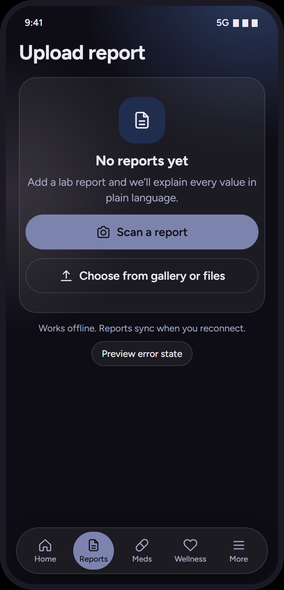
1. `h1` "Upload report"
2. Empty-state card: 64 icon tile (file 28) · `h2` "No reports yet" · muted "Add a lab report and we’ll explain every value in plain language." · primary 📷 "Scan a report" · ghost ↑ "Choose from gallery or files"
3. Centred muted small: "Works offline. Reports sync when you reconnect." (The "Preview error state" chip is a mockup affordance; do not build.)

**Loading** 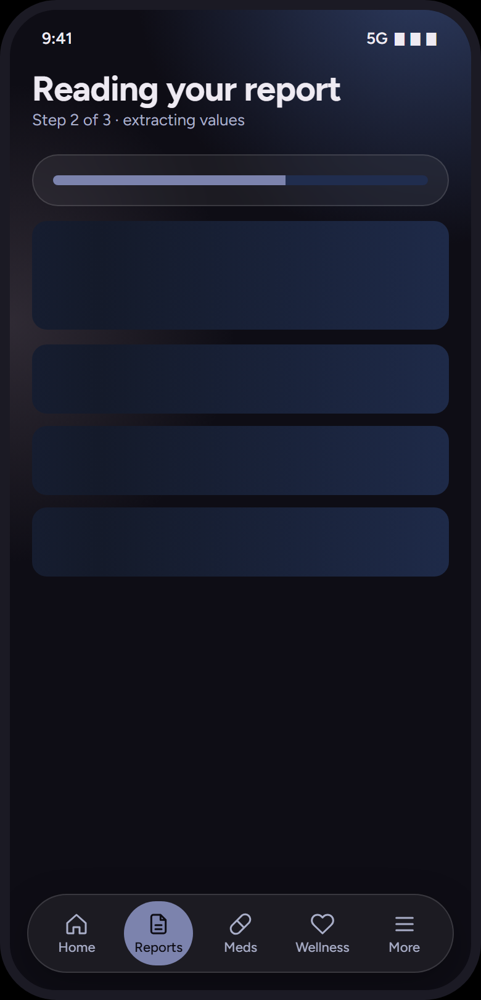
1. `h1` "Reading your report" · subtitle "Step 2 of 3 · extracting values"
2. Card containing an 8 px progress bar at 62 %
3. Skeleton blocks: 88 high, then 3 × 56 high (gaps 12, 10, 10)
4. On completion → navigate to Report and toast **"Report ready. 2 values need attention"**

**Error** 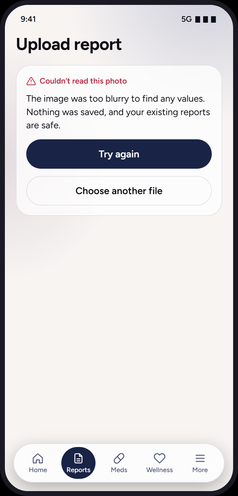
1. `h1` "Upload report"
2. Card: tag.error ⚠ "Couldn’t read this photo" · body "The image was too blurry to find any values. Nothing was saved, and your existing reports are safe." · primary "Try again" · ghost "Choose another file"

Differs from current: current has `AppBar("Report scanner")`, a `_ScanFrame` corner illustration, eyebrow "REPORT OCR", **Step 1 language `SegmentedButton`** (English/Urdu/Roman Urdu) with description, Step 2 "Take photo" / "Choose report file" buttons, format `StatusChip`s, a 4-phase `_LoadingView` with `BrandGradientProgress`, an `ErrorState` with illustration, and a `_SuccessView` showing raw extracted text + confidence + "Simplify this report". Mockup collapses success into the Report screen and has **no language picker or extracted-text view**.

Checklist:
- [ ] Empty: `EmptyState(icon, title, body, primary, ghost)` inside a card; footer muted line.
- [ ] Keep language selection but as a **chip row** under the title (*extrapolated*; required by the OCR API). Default English.
- [ ] Loading: header subtitle steps ("Step 1 of 3 · uploading", "Step 2 of 3 · extracting values", "Step 3 of 3 · explaining"), `ProgressBar` in a card, 4 `SkeletonBox`es. Drop phase list.
- [ ] Error: `ErrorCard(tag, body, primary, ghost)`; copy as above (no status codes).
- [ ] Success → push Report screen and show toast; keep extracted text reachable from the report (*extrapolated*: an "Original text" ghost compact button or a bottom sheet) so OCR accuracy stays checkable.
- [ ] When reports exist the Reports tab should list them (*extrapolated* from "Latest report" row + "Shared records" rows: card of `ListRow`s, 40 icon tile, bold title "Blood test, 18 Oct", muted small summary, chevron) with the upload CTA as a compact primary in the header.

### 2.4 Simplified report → `simplify_screen.dart` (`SimplifiedReportPage`)

Nav: Reports. 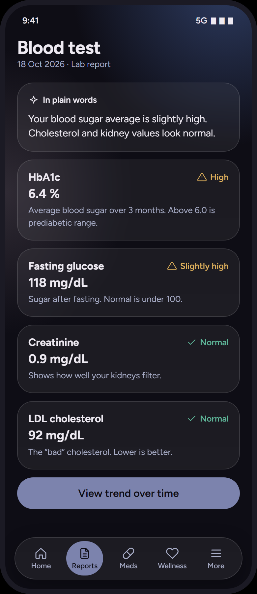

Layout:
1. `h1` "Blood test" · subtitle "18 Oct 2026 · Lab report"
2. Card: tag ✦ "In plain words" · body "Your blood sugar average is slightly high. Cholesterol and kidney values look normal."
3. **Value cards** (one per analyte): row [bold name … status label] · `h2` value (margin 4 0) · muted small explanation
   - HbA1c · **6.4 %** · ⚠ High (warn) · "Average blood sugar over 3 months. Above 6.0 is prediabetic range."
   - Fasting glucose · **118 mg/dL** · ⚠ Slightly high (warn) · "Sugar after fasting. Normal is under 100."
   - Creatinine · **0.9 mg/dL** · ✓ Normal (ok) · "Shows how well your kidneys filter."
   - LDL cholesterol · **92 mg/dL** · ✓ Normal (ok) · "The “bad” cholesterol. Lower is better."
4. Primary "View trend over time" → trends

Differs from current: current shows `AppBar("Simplified report")`, Hero `IconTile(check)`, eyebrow "SIMPLIFIED", "Rewritten in plain language", term/sentence `StatusChip`s, a **Plain language / Original text `SegmentedButton`**, one big text card, a "Not medical advice" `InfoBanner`, and "Back to reports" / "Scan another report" buttons. Mockup is **structured per value** with a one-paragraph summary.

Checklist:
- [ ] Header: report title + "date · Lab report".
- [ ] Summary card with `CardTag(sparkles, "In plain words")`.
- [ ] `ValueCard(name, value, status: ValueStatus, explanation)` list; status via `StatusLabel` (icon + word, coloured text, no pill).
- [ ] Primary "View trend over time" (only when ≥ 2 reports share an analyte; else hide *extrapolated*).
- [ ] Keep the medical disclaimer as a muted small line under the summary (*extrapolated*, mockup puts "This isn’t a diagnosis" copy on the trends card).
- [ ] Original OCR text: secondary access only (see 2.3); drop the segmented toggle.
- [ ] Back navigation = system back; drop the two footer buttons.

### 2.5 Risk trend → **new** (no current screen)

Nav: Reports. 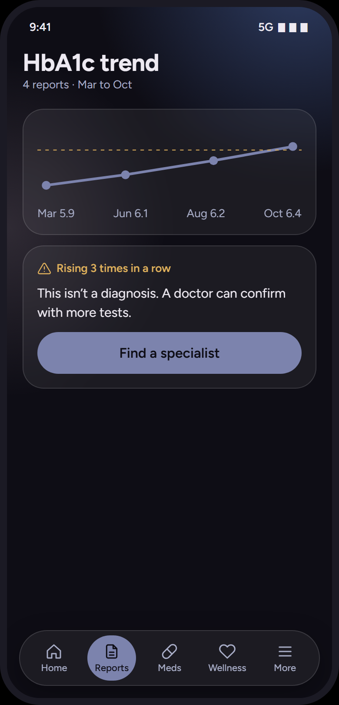

1. `h1` "HbA1c trend" · subtitle "4 reports · Mar to Oct"
2. Card: sparkline (points 5.9, 6.1, 6.2, 6.4; dashed warn threshold at 6.0) · row `space-between` muted small: "Mar 5.9" "Jun 6.1" "Aug 6.2" "Oct 6.4". Semantics label: "HbA1c rose from 5.9 to 6.4 over four reports".
3. Card: tag.warn ⚠ "Rising 3 times in a row" · body "This isn’t a diagnosis. A doctor can confirm with more tests." · primary "Find a specialist" → doctor

Checklist: `Sparkline` `CustomPainter` (stroke 3 primary, r5 dots, dashed warn line), `CardTag` warn, `PrimaryButton`.

### 2.6 Drug safety → **new**

Nav: Meds. 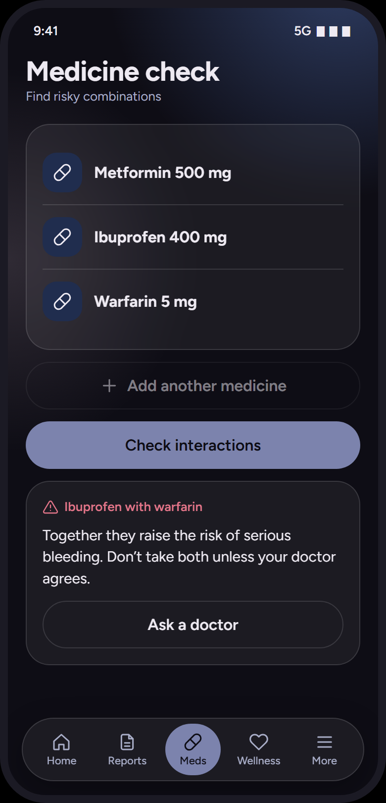

1. `h1` "Medicine check" · subtitle "Find risky combinations"
2. Empty: card with 64 icon tile (pill) · `h2` "No medicines added" · muted "Add what you take. We’ll flag combinations that can cause harm."
   List: card of `ListRow`s (40 pill tile · bold "Metformin 500 mg" / "Ibuprofen 400 mg" / "Warfarin 5 mg")
3. Ghost ＋ "Add first medicine" / "Add another medicine" (disabled at 3 in the mockup, opacity .5) · toast "Medicine added"
4. If ≥ 2: primary "Check interactions"
5. Result card (mt 12): tag.error ⚠ "Ibuprofen with warfarin" · body "Together they raise the risk of serious bleeding. Don’t take both unless your doctor agrees." · ghost "Ask a doctor" → doctor

### 2.7 Medicine scanner → **new**

Nav: Meds.

**Permission** 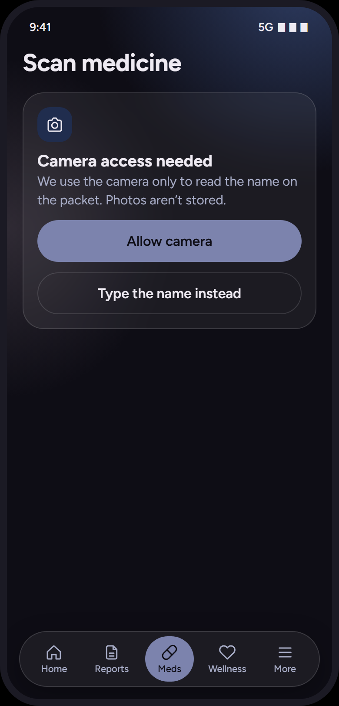 `h1` "Scan medicine" · card: 40 icon tile (camera) · `h2` (mt 10) "Camera access needed" · muted "We use the camera only to read the name on the packet. Photos aren’t stored." · primary "Allow camera" · ghost "Type the name instead" → meds

**Viewfinder** 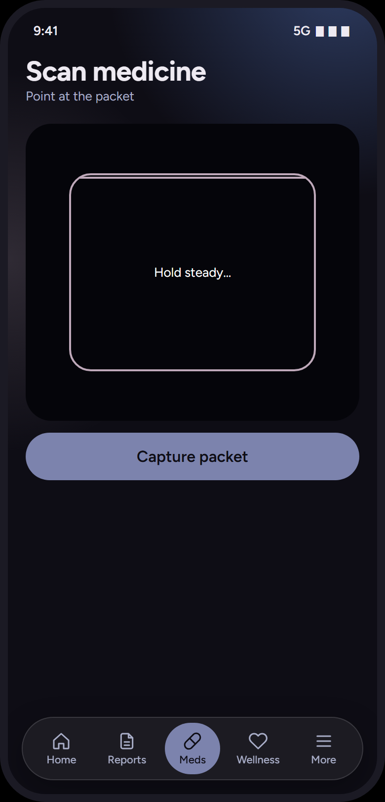 `h1` "Scan medicine" · subtitle "Point at the packet" · 300 high viewfinder with mauve frame + sweep line, centred small "Hold steady…" · primary "Capture packet"

**Matched** 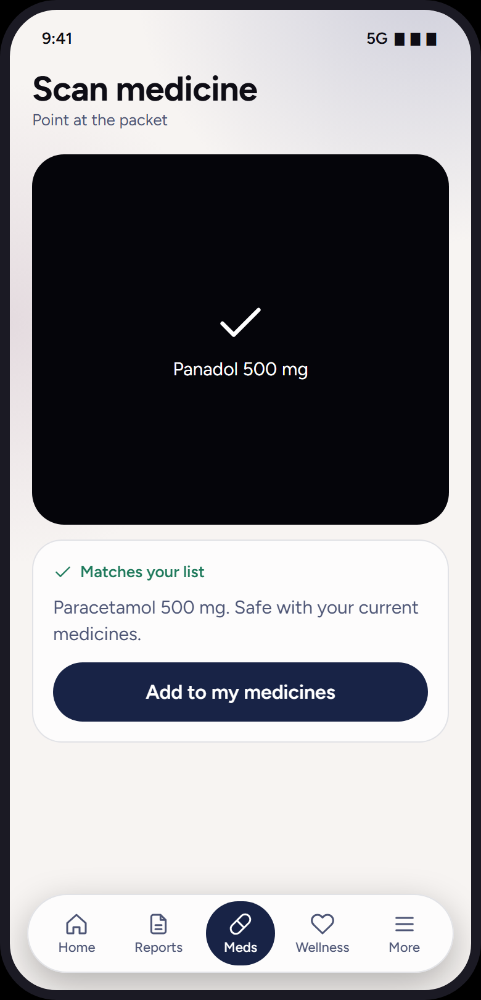 viewfinder shows ✓ (44) + "Panadol 500 mg" · card: tag.ok ✓ "Matches your list" · muted "Paracetamol 500 mg. Safe with your current medicines." · primary "Add to my medicines" → meds

Note: the existing report-camera permission dialogs in `upload_screen.dart` (`AlertDialog`s) should adopt this in-content permission card pattern instead of dialogs (*extrapolated*).

### 2.8 Doctor match → **new**

Nav: none highlighted (reached from home / trends / meds). 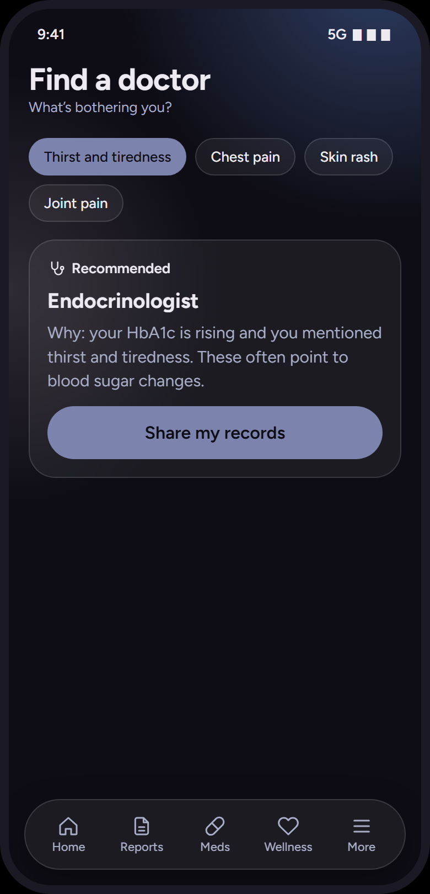

1. `h1` "Find a doctor" · subtitle "What’s bothering you?"
2. Chip wrap: "Thirst and tiredness", "Chest pain", "Skin rash", "Joint pain" (single-select)
3. None selected: empty card, muted "Pick a symptom to see which specialist fits."
   Selected: card (mt 16): tag 🩺 "Recommended" · `h2` "Endocrinologist" · muted (m 6 0) "Why: your HbA1c is rising and you mentioned thirst and tiredness. These often point to blood sugar changes." · primary "Share my records" → qr

### 2.9 Wellness → **new**

Nav: Wellness. 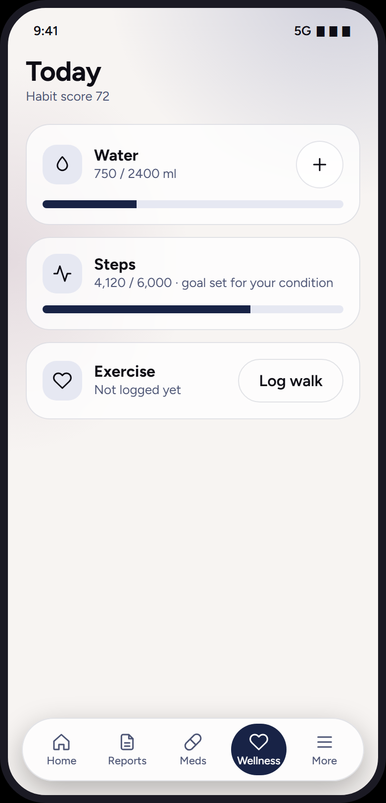

1. `h1` "Today" · subtitle "Habit score 72"
2. Card: row [40 tile 💧 · bold "Water" · muted small "750 / 2400 ml" · 48 icon button ＋ (aria "Add 250 ml")] · bar (mt 12) 31 % · toast "Added 250 ml of water"; cap 9 × 250
3. Card: row [40 tile 〰 · bold "Steps" · muted small "4,120 / 6,000 · goal set for your condition"] · bar 69 %
4. Card: row [40 tile ♡ · bold "Exercise" · muted small "Not logged yet" · ghost compact "Log walk" (margin 0)]

### 2.10 QR share → **new**

Nav: none. 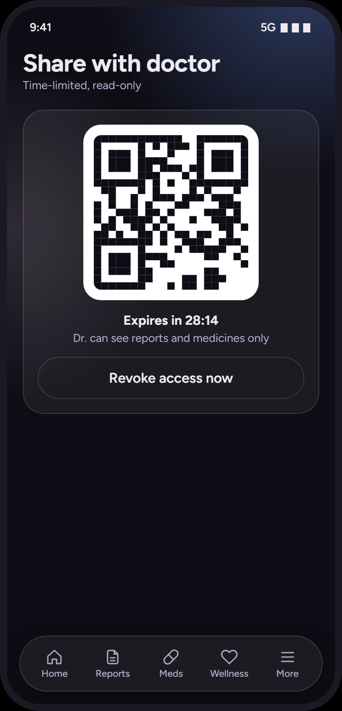

**Empty**: `h1` "Share with doctor" · subtitle "Time-limited, read-only" · empty card: 64 tile (qr) · `h2` "No active codes" · muted "Create a code your doctor scans to view selected records. You choose how long it lasts." · row gap 8 of three **selected** chips, `flex 1`, centred, `min-height 44`: "15 min" "30 min" "60 min" · primary "Create code" (default 30) · toast "Code created for 30 minutes"

**Active**: card: 200 QR on white plate · centred bold (mt 12) "Expires in **28:14**" (mm:ss live countdown) · centred muted small "Dr. can see reports and medicines only" · ghost "Revoke access now" · toast "Access revoked". Expiry → back to empty.

### 2.11 Doctor-side view → **new** (web/portal; optional in app)

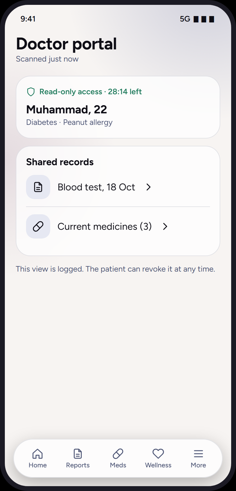 `h1` "Doctor portal" · subtitle "Scanned just now" · card: tag.ok 🛡 "Read-only access · 28:14 left" · `h2` "Muhammad, 22" · muted small "Diabetes · Peanut allergy" · card: bold "Shared records" · `ListRow` file "Blood test, 18 Oct" › · `ListRow` pill "Current medicines (3)" › · muted small "This view is logged. The patient can revoke it at any time."

### 2.12 Settings ("More" tab) → `profile_screen.dart` (appearance section) + new

Nav: More. 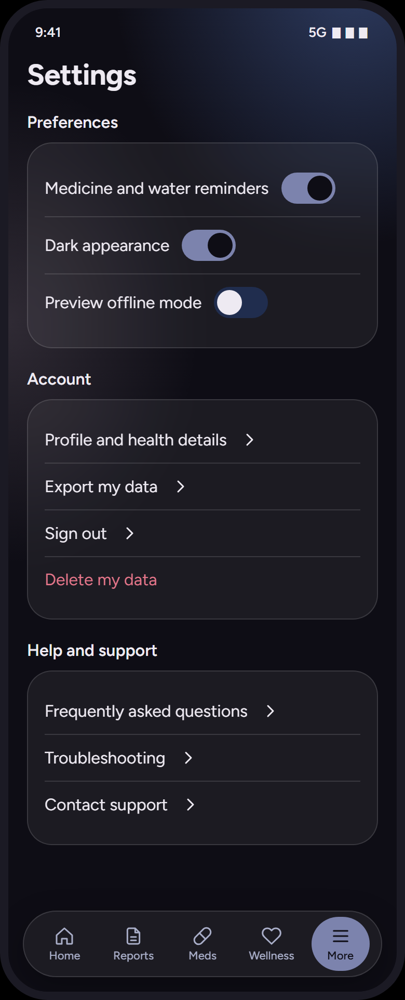

1. `h1` "Settings"
2. `h3` "Preferences" · card: `ListRow` "Medicine and water reminders" [toggle on] · "Dark appearance" [toggle] · "Preview offline mode" [toggle, mockup-only]
3. `h3` "Account" · card: "Profile and health details" › · "Export my data" › · "Sign out" › · "Delete my data" (error colour, no chevron)
4. `h3` "Help and support" · card: "Frequently asked questions" › · "Troubleshooting" › · "Contact support" ›

Differs from current: current `ProfileScreen` is the whole form (header avatar with gradient, three `_FormSection` cards, Save/Delete, Appearance `ListTile` → bottom sheet with System/Light/Dark). Mockup: Settings is a grouped list; the profile form becomes a **sub-page** "Profile and health details"; "Dark appearance" is a single toggle (keep the System option as a third row *extrapolated*, or map toggle → dark/light and expose "Use system setting" below). Sign-out moves here from the home AppBar.

### 2.13 Global overlays

- **Offline banner** (`S.off`): first child of the scroll content on every screen: ⚠ "You’re offline. Changes are saved and will sync later." 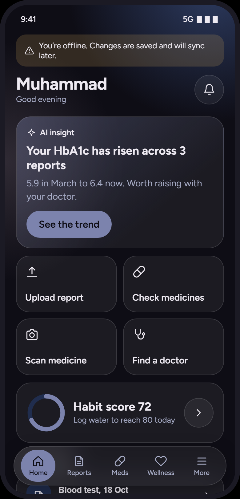
- **Toast**: see §1.7. Messages used: "Report ready. 2 values need attention", "Medicine added", "Added 250 ml of water", "Code created for N minutes", "Access revoked".

### 2.14 App screens not in the mockup — how to extrapolate

| Screen | Guidance |
|---|---|
| **Sign-in** (`auth_screen.dart`) | No AppBar. Keep `BrandLockup` centred (the only place the logo gradient appears), then `h1` "Welcome back" / "Create your MedAIx account" with muted subtitle, inputs (`surface2` fill, radius 16, 48–52 high, no border, 2 px `text` focus ring), primary "Sign in", ghost "Continue with Google", text link "New here? Create an account". Drop `_AtmosphericBackdrop` blue/teal discs in favour of the §1.5 slate/mauve page glow. Replace `_MethodCard`s and the "OR" divider with a plain stacked layout. Messages → `ErrorCard` / ok tag rather than `InfoBanner`. |
| **Splash / lockup** (`brand.dart`) | Unchanged artwork. `SplashScreen` background = `background`; the white lockup plate stays (border → `glassBorder`). `BrandGradientProgress` is removed everywhere else (progress = `ProgressBar`). |
| **Profile edit form** (`profile_screen.dart`) | Becomes Settings › "Profile and health details": header `h1` "Profile" · subtitle "These personalise how reports are explained." · chips row for age/sex/weight/height summary → `AppChip`s · `h3` groups ("About you", "Body measurements", "Health background") each a card of inputs · chip multi-select for conditions/allergies as in onboarding · primary "Save profile" · error-coloured list row "Delete my data". |
| **Reports list** (`SimplifyReportScreen`) | See 2.3 last bullet: card of `ListRow`s. Simplify action = tapping the row (navigates to Report; if not yet simplified, run simplify with the loading screen). |
| **Gate loading / error** (`_GateStatus`) | Loading: lockup + `ProgressBar` (indeterminate) + muted small. Error: `ErrorCard` with primary "Try again", ghost "Sign out". |
| **Update dialog, bottom sheets, dialogs** | Sheet/dialog surface = `surface`, radius 24, no elevation; buttons as §1.7. Prefer in-content cards over `AlertDialog` (camera permission, sign-out confirm → bottom sheet with primary/ghost). |

---

## 3. Palette reconciliation with the brand system

Brand (`docs/color-system.md`, `AppTheme`): Ink `#0E0D15`, Navy `#182346`, Steel `#3D5387`, Slate `#7C83AD`, Mauve `#BFA9BA`; logo gradient blue `#2D7DF5` → teal `#1FCFA4`.

| Topic | Current `theme.dart` | Mockup | Conflict? | Resolution (mockup wins for UI; logo stays) |
|---|---|---|---|---|
| Light primary | Steel `#3D5387` | **Navy `#182346`** | Yes | Use Navy. Steel is demoted to the dark glow only. |
| Dark primary | Slate `#7C83AD` | Slate `#7C83AD` | No | Keep. |
| Light background | `#F4F5F9` (cool) | `#F7F4F2` (warm) | Yes | Use `#F7F4F2`. |
| Dark surfaces | `#181B2E` cards, `#121526` low, `#232C48` high | cards = glass `rgba(255,255,255,.06)`; `#141A2A` / `#202D4E` only for shimmer/tiles | Yes | Cards are translucent glass over the glow, not opaque tonal steps. `#202D4E` for icon tiles / tracks. |
| Text | dark `#E6E4EE`, light Ink | dark `#EEEAF2`, light Ink | Minor | Use mockup. |
| Muted | dark `#A3A9CC`, light `#5B6186` | dark `#A9AEC8`, light `#4D5575` | Minor | Use mockup (light muted darker → better contrast). |
| Success / warn / error (dark) | `#8FCBA6` / `#E2B978` / `#F09A95` + containers | `#5FB89A` / `#E0B15C` / `#E5768A`, **text-only, no containers** | Yes | Use mockup values; drop `*Container` tints except `warnTint` (offline banner). |
| Success / warn / error (light) | `#1E6B3D` / `#8A5200` / `#B3261E` | `#1F7A5C` / `#8A5A00` / `#B3283F` | Minor | Use mockup. |
| Mauve | tertiary / light secondary | glow + scan frame only | Yes | Decorative only. |
| **Logo gradient** blue→teal | `HeroPanel` glow, `IconTile(gradient)`, step indicator, `BrandGradientProgress`, avatar, `AppShadows.raised` teal | **absent** | Yes | Keep the gradient exclusively inside `BrandMark` / `BrandLockup` bitmaps. Remove `brandGradient` / `brandGradientDeep` usage from all UI widgets. |
| Font | Figtree headings + Noto Sans body | Figtree only | Yes | Figtree for all Latin UI. Keep a Noto fallback **only** for OCR text in Urdu script (Figtree has no Arabic glyphs; `NotoSans-*.ttf` bundled is Latin-only, so add Noto Sans Arabic / Nastaliq if Urdu display matters). |
| Radii | 10 / 14 / 20 / 28 | 14 / 17 / 22 / 24 / 32, buttons full pill | Yes | Adopt mockup radii. |
| Elevation | light cards shadowed, hero raised | none except nav | Yes | Remove card shadows; nav shadow `0 10 30 rgba(0,0,0,.28)`. |
| Status presentation | `StatusChip` pills with tinted fills | inline `StatusLabel` + `CardTag` | Yes | Use mockup pattern; colour never alone (rule kept). |

### 3.1 Reconciliation with the in-flight implementation (`app/lib/theme`, `app/lib/core/widgets`)

The parallel refactor already encodes most tokens correctly (`AppColors.dark/light` hexes match §1.1; `FloatingNav` 64/14/32/56×52; `PrimaryButton` 48 pill). Deviations from the mockup spotted while reading (read-only):

1. `app_theme.dart` states "no gradients, no blur, no translucent surfaces" and `AppColors.surface` (`#141A2A` / `#FFFFFF`) is used as the **card** fill. In the mockup, cards/tiles/chips/icon-buttons/nav use **`--gl` glass** (`rgba(255,255,255,.06)` / `.75`) with a 1 px **`--gb`** border and `backdrop-filter`. `--s1` is only the skeleton base. Recommend adding `glass` + `glassBorder` tokens and using them on `AppCard`, `TileButton`, `AppChip`, `AppIconButton`, `FloatingNav`; `BackdropFilter(ImageFilter.blur(16))` is optional on low-end devices but the alpha fill + hairline are not.
2. `GhostButton` / `OutlinedButtonTheme` fill with `surface2`. Mockup `.btn.g` is **transparent with a 1 px `glassBorder`**.
3. `hairline` is opaque (`#2D3B61` / `#DCDDE8`). Mockup divider/border is `--gb` (alpha). Fine as a composite for dividers, but borders on glass should use the alpha value.
4. The page **radial glows** (§1.5) and the **AI card gradient** (§1.8) are part of the mockup and should be kept (they are the only "atmosphere" once the HeroPanel goes).
5. `IconButtonTheme` shape `CircleBorder` ✓; ensure `AppIconButton` draws `glass` fill + `glassBorder` (mockup `.ib`), not transparent.

---

## 4. Flutter mapping

### 4.1 `AppColors` (ThemeExtension) and `ColorScheme`

```dart
// Dark                                   // Light
background   0xFF0E0D15                   0xFFF7F4F2
surface      0xFF141A2A  (skeleton base)  0xFFFFFFFF
surface2     0xFF202D4E                   0xFFE6E8F2
primary      0xFF7C83AD                   0xFF182346
onPrimary    0xFF0E0D15                   0xFFFFFFFF
text         0xFFEEEAF2                   0xFF0E0D15
muted        0xFFA9AEC8                   0xFF4D5575
glass        Color(0x0FFFFFFF)  (6 %)     Color(0xBFFFFFFF) (75 %)
glassBorder  Color(0x21FFFFFF)  (13 %)    Color(0x1F182346) (12 %)
ok           0xFF5FB89A                   0xFF1F7A5C
warn         0xFFE0B15C                   0xFF8A5A00
error        0xFFE5768A                   0xFFB3283F
glowPrimary  0xAA3D5387                   0x557C83AD
glowSecondary 0x30BFA9BA                  0x55BFA9BA
viewfinder   0xFF05050A  onViewfinder 0xFFFFFFFF  scanFrame 0xFFBFA9BA
qrInk 0xFF0E0D15  qrPaper 0xFFFFFFFF
warnTint = warn.withValues(alpha: .18)
```

`ColorScheme` derivation: `primary/onPrimary` as above; `surface = background` (page), `surfaceContainer = surface2`, `onSurface = text`, `onSurfaceVariant = muted`, `outline/outlineVariant = glassBorder`, `error = error`, `onError = onPrimary`, `inverseSurface = text`, `onInverseSurface = background` (toast), `surfaceTint = transparent`.

### 4.2 `TextTheme` (all Figtree)

| Slot | Size / weight / height / tracking |
|---|---|
| `headlineMedium` (h1) | 28 / w700 / 1.15 / −0.4 |
| `headlineSmall` | 24 / w700 / 1.2 / −0.3 (*extrapolated* for sheets) |
| `titleLarge` (h2) | 19 / w600 / 1.25 |
| `titleMedium` (h3) | 16 / w600 / 1.25 |
| `titleSmall` (tile) | 15 / w600 / 1.2 |
| `bodyLarge` / `bodyMedium` (p) | 15 / w400 / 1.45 |
| `bodySmall` (.sm) | 13 / w400 / 1.45 |
| `labelLarge` (button) | 16 / w600 / 1.2 |
| `labelMedium` (tag / status / chip) | 13 / w600 / 1.2 (chip overrides to w500) |
| `labelSmall` (nav) | 11 / w500 / 1.2 |

### 4.3 ThemeData component themes

| Theme | Values |
|---|---|
| `scaffoldBackgroundColor` | `background`; `extendBody: true` on shell scaffold |
| `appBarTheme` | unused on mockup screens; if kept for sub-pages: bg `background`, no elevation, title `headlineMedium` |
| `filledButtonTheme` | min `Size(double.infinity, 48)`, `StadiumBorder`, bg `primary`, fg `onPrimary`, text `labelLarge`, disabled opacity .5 |
| `outlinedButtonTheme` (ghost) | same size, `StadiumBorder`, bg transparent, `BorderSide(glassBorder, 1)`, fg `text` |
| `iconButtonTheme` | 48 × 48 `CircleBorder`, bg `glass`, side `glassBorder`, icon 20 `text` |
| `chipTheme` | height 34, padding `0 13`, `StadiumBorder`, bg `glass`, side `glassBorder`, label 13/w500 `text`; selected bg `primary`, label `onPrimary`, side none, checkmark 14 |
| `cardTheme` | radius 24, color `glass`, side `glassBorder`, elevation 0, margin 0 |
| `progressIndicatorTheme` | `linearMinHeight 8`, radius 4, color `primary`, track `surface2` |
| `switchTheme` | 52 × 30: track `surface2`/`primary`, thumb `text`/`onPrimary`, no outline |
| `snackBarTheme` | floating, bg `text`, text `background` 14/w600, radius 18, inset `24, 0, 24, 92 + safeBottom` |
| `dividerTheme` | `glassBorder`, 1 px |
| `bottomSheetTheme` / `dialogTheme` | bg `surface` (dark `#141A2A`), radius 24, elevation 0 |
| `inputDecorationTheme` (*extrapolated*) | filled `surface2`, radius 16, no border, focus `BorderSide(text, 2)`, padding 16 |
| `pageTransitionsTheme` | fade-through / `FadeForwardsPageTransitionsBuilder`, ≤ 250 ms, zero when `disableAnimations` |

### 4.4 Shared widgets to build (dimensions)

| Widget | API | Dimensions / notes |
|---|---|---|
| `AppScreen` | `header`, `children`, `offline` | Stack: `PageGlow` → `ListView(padding: 8+safeTop, 18, 110+safeBottom, 18)` → optional offline banner first → `FloatingNav` (if tabbed). |
| `PageGlow` | – | two radial gradients: `(center Alignment(0.8,-1.08), rx 90 %, ry 40 %, glowPrimary→transparent 70 %)` and `(center Alignment(-1,-0.36), rx 70 %, ry 35 %, glowSecondary→transparent 70 %)`. |
| `ScreenHeader` | `title`, `subtitle?`, `trailing?` | Row space-between, bottom margin 18; title `headlineMedium`, subtitle `bodySmall` muted; trailing 48 `AppIconButton`. |
| `SectionTitle` | `text` | `titleMedium`, padding `20 0 10`. |
| `FloatingNav` | `items`, `selectedIndex`, `onSelected` | 64 high, inset 14, radius 32, `glass`+`glassBorder`, blur 20, shadow `(0,10,30,.28)`; items 56 × 52 radius 26, icon 20 + 2 + label 11; active fill `primary`. |
| `AppCard` | `child`, `onTap?`, `gradient: false` | radius 24, padding 16, `glass` + 1 px `glassBorder`, optional `BackdropFilter(blur 16)`; `gradient` → AI variant `LinearGradient(140°, [primary α.38, glass], stops [0, .7])`. |
| `CardTag` | `icon`, `text`, `tone: neutral/ok/warn/error` | icon 16, gap 6, `labelMedium`; tone colours icon + text; bottom margin 8. |
| `StatusLabel` | `status: ValueStatus`, `text` | icon 15 (✓ ok / ⚠ warn,error), gap 5, `labelMedium`, text coloured. |
| `PrimaryButton` | `label`, `icon?`, `onPressed`, `loading`, `compact` | 48 high pill, full width; compact: 44 high, `padding 0 20`, hug. Top margin 12 by caller. |
| `GhostButton` | same | transparent, 1 px `glassBorder`, `text`. |
| `AppIconButton` | `icon`, `onPressed`, `semanticLabel` | 48 circle, `glass` + `glassBorder`, icon 20. |
| `TileButton` | `icon`, `label`, `onTap` | min-height 92, radius 22, padding 14, icon 22 top-left, `titleSmall` bottom-left; grid 2 × gap 10. |
| `AppChip` | `label`, `selected`, `icon?`, `onTap` | 34 high, `0 13`, radius 17; selected `primary`/`onPrimary` + check 14. |
| `IconTile` | `icon`, `size: 40/64` | 40 → radius 14 icon 20; 64 → radius 22 icon 28; fill `surface2`. |
| `ListRow` / `ListRows` | `leading?`, `title`, `subtitle?`, `trailing?`, `tone` | gap 12, padding `12 0`, 1 px `glassBorder` divider except last; trailing chevron 20 or `AppSwitch`. |
| `ProgressBar` | `value` | 8 high, radius 4. |
| `SkeletonBox` | `height`, `width?` | radius 12, shimmer `surface→surface2→surface` 1.3 s. |
| `EmptyState` | `icon`, `title`, `body`, `primary?`, `ghost?` | centred, padding `26 8`, 64 `IconTile`, `titleLarge`, muted body. |
| `ErrorCard` | `title`, `body`, `primary`, `ghost?` | `AppCard` with `CardTag(error)`. |
| `OfflineBanner` | `text` | padding `10 14`, radius 16, `warnTint`, icon 16, `bodySmall` text, bottom margin 12. |
| `AppSwitch` | `value`, `onChanged` | 52 × 30, knob 24, 200 ms. |
| `ScoreRing` | `size 64`, `value`, `label` | stroke 4, track `surface2`, arc `primary` round cap, start −90°. |
| `Sparkline` | `points`, `threshold?` | stroke 3, dots r5, dashed threshold `warn` `[4,5]`. |
| `Viewfinder` | `state: scanning/matched`, `label` | 300 high radius 26 `viewfinder`; frame inset `50 44` 2 px `scanFrame` radius 22; sweep 2 px 2 s alternate; matched: check 44 + `bodyLarge` white. |
| `QrCard` | `expiresIn`, `onRevoke` | 200 QR on `qrPaper` padding 12 radius 20; "Expires in mm:ss" `bodyLarge` w700; muted small; `GhostButton`. |
| `AppToast` | `show(context, text)` | via `SnackBar` theme above, auto-hide 1800 ms. |

---

## 5. Top 10 most visible changes vs. the current app

1. **Bottom nav**: Material `NavigationBar` (3 tabs, full-width, top hairline, 72 high) → floating glass pill, 5 tabs, 64 high, inset 14, active item a filled `primary` pill.
2. **No AppBars**: every screen opens with a 28 px Figtree `h1` + muted subtitle in the content; the brand mark/wordmark leaves the top of every screen (logo only on splash and sign-in).
3. **Home rebuilt**: greeting-by-name header with bell, AI insight card, 2 × 2 action tiles, habit-score ring card, "Latest report" row. The gradient `HeroPanel`, "How it works" timeline and service-status card are gone.
4. **Palette**: blue→teal logo gradient disappears from all UI; light primary becomes Navy; warm `#F7F4F2` light background; status colours become text-only labels.
5. **Glass cards**: opaque, shadowed cards (radius 20) → translucent `rgba(255,255,255,.06/.75)` cards with 1 px hairline, radius 24, no shadow, blur; two soft slate/mauve glows behind the page.
6. **Buttons**: 52-high radius-14 `FilledButton`/`OutlinedButton` → 48-high full pills; ghost = transparent + hairline; compact 44-high inline pill for in-card CTAs.
7. **Typography**: Figtree + Noto Sans → Figtree only; h1 28/700/−0.4, h2 19/600, body 15/1.45; eyebrow caps labels ("REPORT OCR", "SIMPLIFIED") replaced by icon + 13/600 `CardTag`s.
8. **Upload flow**: language `SegmentedButton`, Step headers, corner-frame illustration and extracted-text success page → one empty-state card with two stacked pills, a progress-bar + skeleton loading screen, and success landing directly on the structured report with a toast.
9. **Report page**: single text block with Plain/Original toggle → "In plain words" summary card + one card per value (name, ⚠/✓ status word, big value, one-line explanation) + "View trend over time".
10. **Onboarding & profile**: text-field steps with gradient step bars → chip multi-select (conditions, allergies, "+ Add"), 8 px progress bar, "Step 2 of 4 · 2 minutes", Continue/Skip pills; profile editing moves under Settings › "Profile and health details", and Settings becomes a grouped list (Preferences / Account / Help) with the new toggle style.

New surfaces not in the current app: Risk trend, Medicine check, Medicine scanner, Find a doctor, Wellness, QR share, Doctor portal, Settings, offline banner, toast.
